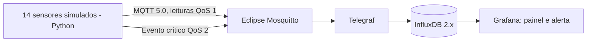

# FrioCerto — Parte B (AF12 IoT + Big Data)

Laboratório funcional que simula o monitoramento de 14 farmácias no ABC paulista,
com câmaras frias entre 2 °C e 8 °C. O dashboard central recebe medições periódicas,
mostra a anomalia de uma loja e avalia uma regra de alerta de 5 minutos.

**O código é um projeto de laboratório e precisa ser executado e fotografado de verdade.**
Não utiliza sensores físicos, SMS real ou uma rede NB-IoT operacional.

## Arquitetura



## Consistência com a Parte A

- **Rádio em produção:** NB-IoT (independente do Wi-Fi local). Em laboratório, Python publica via TCP local.
- **MQTT 5.0:** leitura normal **QoS 1** e publicação de evento crítico **QoS 2**.
- **Topic tree:** `friocerto/<regiao>/<cidade>/<loja>/<camara>/<tipo>`.
- **Exemplo:** `friocerto/abc/sao-bernardo/sbc-02/camara01/leitura` e `/alerta`.
- **Measurement:** `temperatura_camara`; tags `regiao`, `cidade`, `loja`, `camara`.
- **Campos:** `temp_c` (°C), `umid_pct` (%); timestamp em UTC.
- **Eventos de negócio:** measurement `alerta_evento` via tópico MQTT de alerta.
- **Bucket:** `sensores`, retenção configurada para `43800h` (1825 dias).
- **Produção:** uma leitura a cada 60 segundos. Laboratório: a cada 2 segundos.

### Por que as tecnologias escolhidas?

- **MQTT em vez de CoAP:** publish/subscribe desacopla sensores e consumidores, com suporte a QoS.
- **QoS 1 leitura:** pelo menos uma entrega MQTT, com possibilidade de duplicatas; precisa deduplicar quando aplicável.
- **QoS 2 alerta:** handshake de entrega exatamente uma vez dentro do fluxo MQTT; não garante SMS nem ação humana.
- **InfluxDB em vez de PostgreSQL:** agrega dados por período com facilidade e é específico para séries temporais.
- **Mosquitto em vez de EMQX:** simples e leve para apenas 14 lojas no laboratório; EMQX pode atender crescimento e clustering.

## Instalação no Codespaces (celular)

1. Envie o ZIP ao GitHub em **Add file → Upload files** e confirme o commit. Na janela do Codespaces, execute:

```bash
git pull --ff-only
unzip -o FrioCerto_ParteB_Codespaces.zip -d .
```

2. Agora remova o ZIP versionado e prepare as credenciais locais:

```bash
git rm FrioCerto_ParteB_Codespaces.zip
bash scripts/preparar.sh
```

3. Suba os quatro serviços (pode demorar na primeira execução):

```bash
docker compose config
docker compose up -d
docker compose ps
```

4. Instale o publisher e inicie a simulação em segundo plano:

```bash
python3 -m venv .venv
.venv/bin/python -m pip install -r requirements.txt
nohup .venv/bin/python -u publisher.py > publisher.log 2>&1 &
tail -n 20 publisher.log
```

5. Faça commit dos arquivos do laboratório:

```bash
git add .
git commit -m "Implementa laboratorio FrioCerto Parte B"
git push origin main
```

**Nunca inclua `.env` no repositório.** Este arquivo é ignorado pelo `.gitignore` e tem
segredos gerados no Codespaces; mantenha as portas encaminhadas como **Private**.

## Grafana

- Na aba **PORTS** do VS Code web, abra o link da porta **3000**.
- Usuário: `admin`.
- Senha: consulte localmente (não compartilhe capturas desta linha): `grep GRAFANA_PASSWORD .env`.
- InfluxDB: porta interna 8086; bucket `sensores`, organização `friocerto`.
- O datasource Flux e o dashboard `FrioCerto — Monitoramento das 14 lojas` são provisionados automaticamente.
- A regra `FrioCerto - Temperatura >8°C por 5 minutos` é provisionada; verifique seu estado em **Alerting → Alert rules**.

## Simulação e screenshots

- Após 20 segundos de execução, a loja `sbc-02` de São Bernardo passa a **12,4 °C**.
- A temperatura permanece elevada por mais de 5 minutos.
- O publisher também envia evento separado MQTT **QoS 2** após 5 minutos.
- No painel do Grafana selecione **Last 15 minutes** e atualize os dados.

**Print 1:** `docker compose ps` com quatro serviços em execução/saudáveis.

**Print 2:** receba 14 mensagens MQTT reais com:

```bash
docker compose exec -T mosquitto mosquitto_sub -h 127.0.0.1 -t 'friocerto/abc/+/+/+/leitura' -v -q 1 -C 14
```

**Print 3:** dashboard do Grafana mostrando as 14 séries e a anomalia em `sbc-02`.

**Print 4:** regra de alerta com limiar >8 °C, avaliação a cada 30 segundos e período de 5 min.

**Print 5:** estado **Firing** ou histórico do Grafana mostrando a transição disparada.

Não é necessário SMS real segundo o enunciado. Uma regra em `Firing` não prova que
uma notificação chegou a um destinatário; use o histórico/log do laboratório
para comprovar o disparo.

## Verificações de funcionamento

```bash
bash scripts/testar.sh
docker compose logs --tail=80 telegraf
docker compose logs --tail=80 grafana
tail -n 30 publisher.log
```

Se o Grafana estiver `unhealthy`, verifique se o comando de healthcheck `wget` existe na versão
baixada (`docker compose logs grafana` e `docker inspect`); não conclua que todo Grafana falhou
somente pelo healthcheck. Os containers requerem imagens baixadas da internet.

### Limitações de produção

O broker do laboratório aceita conexões sem autenticação para simplificar a execução.
Para operação real seriam necessários **mTLS e ACLs**, backup diário e restauração,
high availability, sincronização NTP, calibração, buffer local com reenvio,
alimentação de emergência, retenção auditável e tratamento também da temperatura **abaixo de 2 °C**.
O tempo de 5 anos é uma configuração de retenção, não demonstra por si só auditoria ou backup.

## Referências

- OASIS, *MQTT Version 5.0 Specification*.
- Eclipse Mosquitto (mosquitto.org).
- InfluxDB 2.x e Telegraf (docs.influxdata.com).
- Grafana Alerting (grafana.com/docs).
- Anvisa RDC 430/2020 e Lei 13.709/2018 (LGPD).
